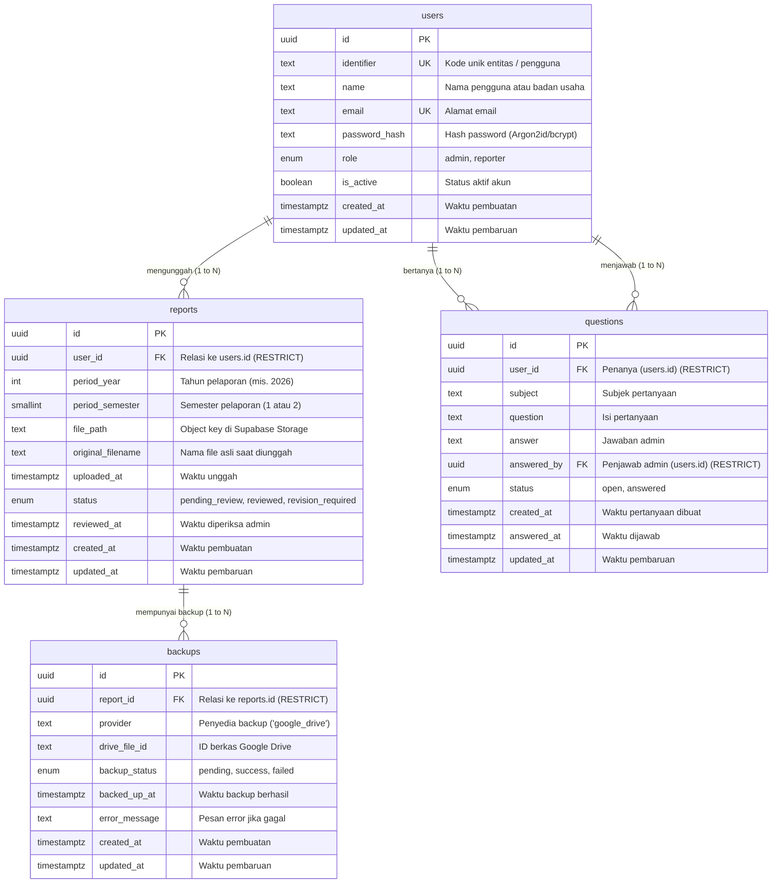

# Entity Relationship Diagram (ERD) — E-Report PBOBA

Dokumen ini memetakan 4 tabel inti sistem E-Report PBOBA sesuai kebutuhan SRS Bagian 4.

## Aturan Integritas Data
1. **Batas Model Data**: Tepat 4 tabel di atas. Tidak ada tabel kelima.
2. **Aturan Foreign Key**: Semua foreign key menggunakan `ON DELETE RESTRICT` eksplisit guna mencegah penghapusan kaskade data pelaporan penting.
3. **Unique Constraint**: Kombinasi `(user_id, period_year, period_semester)` pada tabel `reports` bersifat unik (satu laporan per periode untuk tiap entitas pelapor).
4. **Check Constraint**: Nilai `period_semester` dibatasi hanya 1 atau 2.
5. **Indeks Minimal**:
   - `reports(period_year, period_semester)`
   - `reports(user_id)`
   - `questions(user_id)`
   - `questions(status)`
   - `backups(report_id)`
